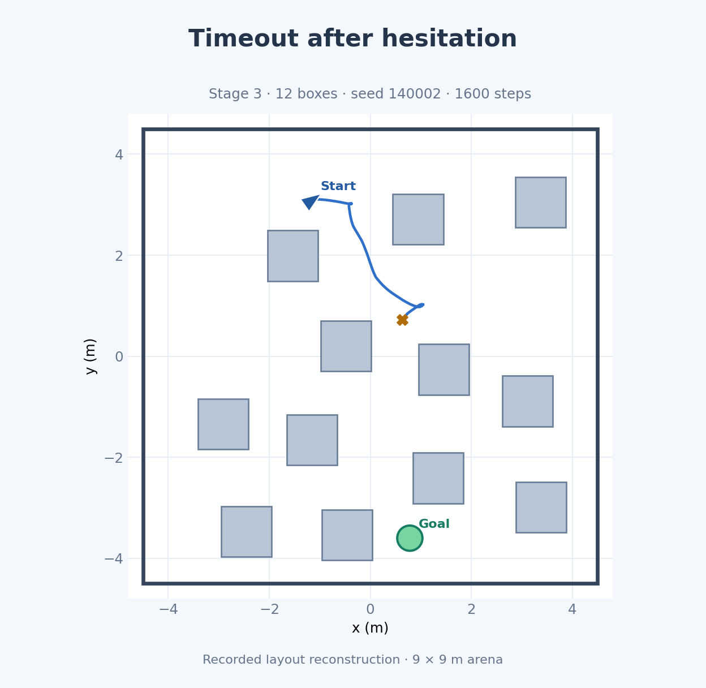

# PPO Robot Navigation · ROS 2 + Gazebo

A differential-drive robot learns to reach random goals among static obstacles using a custom PyTorch PPO implementation, ROS 2 Jazzy and Gazebo Harmonic. Training progresses through 3 m, 6 m and 9 m regions.

| Successful navigation | Timeout example |
|---|---|
|  |  |

*Overhead reconstructions of recorded evaluation layouts and paths; these are not Gazebo screenshots.*

## Results

Deterministic evaluation on **50 Stage 3 layouts**, with **12–15 boxes in a 9 × 9 m arena**:

| Success | Collision | Timeout |
|---:|---:|---:|
| **32/50 · 64%** | **7/50 · 14%** | **11/50 · 22%** |

The evaluated checkpoint contains **687,935 environment steps**, within a **700,000-step training budget**. It is a simulation prototype: hesitation in passages, collisions and timeouts remain.

[Raw results and training plots](docs/results/stage3_687935/README.md) · [Checkpoint and checksum](models/README.md) · [Method](README_CURRICULUM.md)

## Run

Requires Ubuntu 24.04, ROS 2 Jazzy, Gazebo Harmonic, `ros_gz`, and a Python environment with PyTorch. The commands use CUDA and your existing `robotics_ai` environment; adjust its path if needed.

<details>
<summary><strong>Setup, checks, fresh training, resume, evaluation and plotting</strong></summary>

### Setup

```bash
git clone https://github.com/Harivathsha/ros2-hybrid-ppo-navigation.git
cd ros2-hybrid-ppo-navigation
source ~/ai_envs/robotics_ai/bin/activate
source /opt/ros/jazzy/setup.bash
python -m pip install -r src/nav_learning/requirements_rl.txt
colcon build --symlink-install --packages-select description_new nav_learning
source install/setup.bash
```

Repeat the two environment `source` commands and `source install/setup.bash` in each new terminal, from the repository root.

### Simulator — terminal 1

```bash
ros2 launch description_new launch_sim.launch.py
```

Keep this terminal open. Training/evaluation control physics pauses; do not run both controllers together.

### Checks — terminal 2

```bash
python -m pytest src/nav_learning/test -q
python -m nav_learning.train_ppo --config src/nav_learning/config/ppo_training.yaml --timing-check
python -m nav_learning.train_ppo --config src/nav_learning/config/ppo_training.yaml --smoke --run-dir "runs/smoke_$(date +%Y%m%d_%H%M%S)" --device cuda
```

The live timing check should print `TIMING CHECK PASSED` and `TURN CHECK PASSED`. The smoke test runs 256 steps.

### New model from scratch

```bash
mkdir -p runs/ppo_curriculum
export PPO_RUN="$PWD/runs/ppo_curriculum/fresh_$(date +%Y%m%d_%H%M%S)"
printf '%s\n' "$PPO_RUN" > runs/ppo_curriculum/fresh_run_path.txt
python -m nav_learning.train_ppo --config src/nav_learning/config/ppo_training.yaml \
  --run-dir "$PPO_RUN" --total-timesteps 700000 --seed 42 --device cuda
```

This creates new weights using the published current profile. The recorded experiment changed profiles during training, so this is not an exact replay of its learning history.

### Stop and resume your run

Press **Ctrl+C once**, wait for checkpoint saving and the shell prompt, and keep Gazebo open.

```bash
export PPO_RUN="$(cat runs/ppo_curriculum/fresh_run_path.txt)"
python -m nav_learning.train_ppo --config "$PPO_RUN/config_used.yaml" \
  --resume "$PPO_RUN/checkpoints/latest.pt" --run-dir "$PPO_RUN" \
  --total-timesteps 700000 --device cuda
```

The target is cumulative. A run already at 700,000 needs a larger target to continue; omit `--seed` when resuming.

### Continue the published model

```bash
export PPO_RUN="$PWD/runs/ppo_curriculum/continued_$(date +%Y%m%d_%H%M%S)"
mkdir -p "$PPO_RUN/checkpoints"
cp models/ppo_square_arena_687935_steps.pt "$PPO_RUN/checkpoints/latest.pt"
cp src/nav_learning/config/ppo_training.yaml "$PPO_RUN/config_used.yaml"
printf '%s\n' "$PPO_RUN" > runs/ppo_curriculum/fresh_run_path.txt
python -m nav_learning.train_ppo --config "$PPO_RUN/config_used.yaml" \
  --resume "$PPO_RUN/checkpoints/latest.pt" --run-dir "$PPO_RUN" \
  --total-timesteps 700000 --device cuda
```

### Evaluate the published checkpoint

Stop the trainer first; keep Gazebo running.

```bash
export PPO_EVAL_DIR="$PWD/runs/eval_stage3_$(date +%Y%m%d_%H%M%S)"
python -m nav_learning.evaluate_ppo --checkpoint models/ppo_square_arena_687935_steps.pt \
  --levels 2 --episodes-per-level 50 --trajectory-episodes-per-level 50 \
  --seed-base 120000 --output-dir "$PPO_EVAL_DIR" --device cuda
```

Levels `0`, `1`, `2` mean Stages `1`, `2`, `3`. Use `--levels 0 1 2` to test all stages. For your own run, use `--checkpoint "$PPO_RUN/checkpoints/latest.pt"`. Actions are deterministic unless `--stochastic` is supplied.

### Plot

Recreate figures from the included evidence:

```bash
python -m nav_learning.plot_ppo_results --run-dir docs/results/stage3_687935 \
  --evaluation-dir docs/results/stage3_687935 --output-dir runs/plots_published
```

For your own training and evaluation:

```bash
python -m nav_learning.plot_ppo_results --run-dir "$PPO_RUN" \
  --evaluation-dir "$PPO_EVAL_DIR" --output-dir "$PPO_RUN/plots"
```

</details>

The actor receives 72 LiDAR bins plus five goal/motion features and outputs forward and angular velocity. Known obstacle geometry assists the **training reward**, but no planned route or doorway subgoal is supplied to the policy.

Apache-2.0 · [Harivathsha](https://github.com/Harivathsha)

