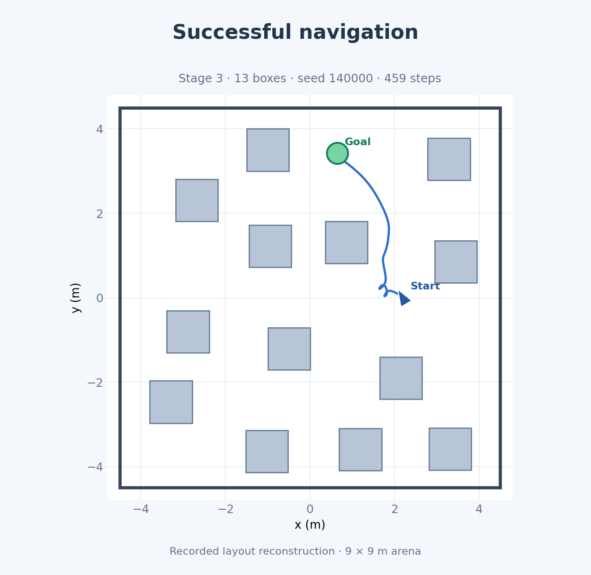
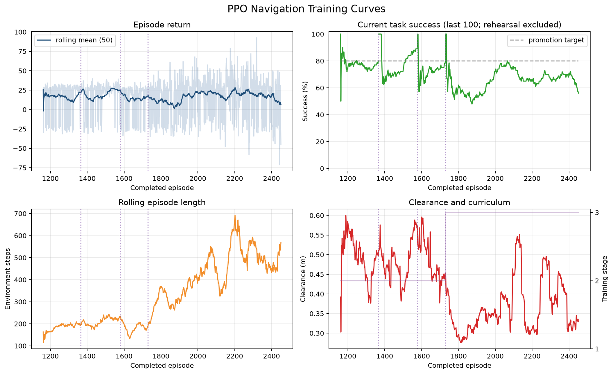
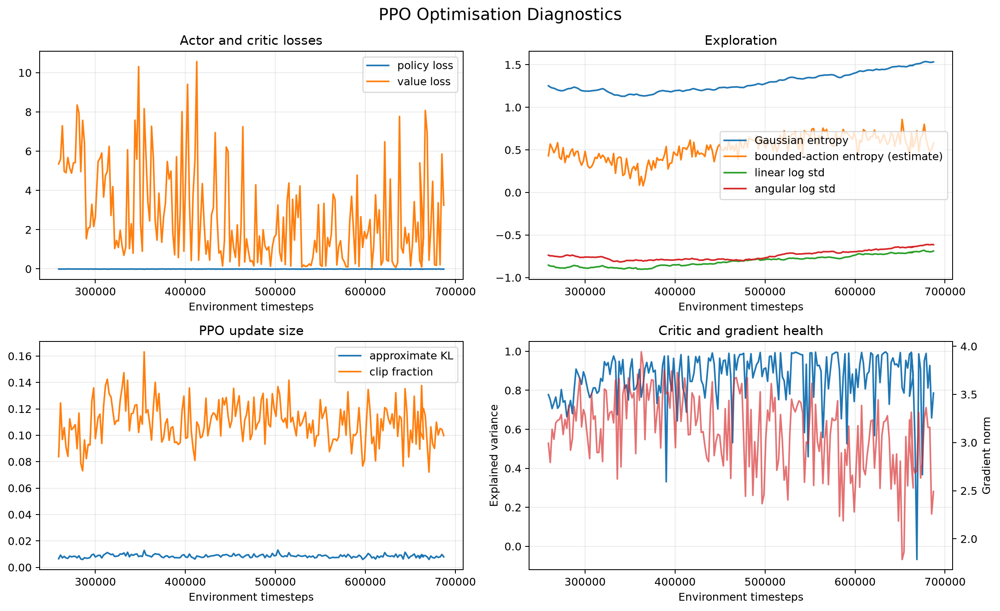

# PPO Robot Navigation with ROS 2 and Gazebo

**ROS 2 Jazzy · Gazebo Harmonic · PyTorch · Curriculum Learning**

A differential-drive robot learns to reach a goal while avoiding randomly placed boxes. The project includes a custom PPO implementation, the robot and simulation assets, curriculum training, checkpoint recovery, evaluation and plotting tools.

The current experiment reached **687,935 environment steps** against a **700,000-step target**. A separate deterministic evaluation achieved **64% success across 50 Stage 3 episodes**. Narrow passages and obstacle corners remain difficult; this is an ongoing simulation project.

## Environment


*Gazebo view of the robot and its obstacle environment.*



*Overhead reconstruction from a recorded evaluation layout and trajectory: seed 140000, 13 boxes, goal reached in 459 steps. This second image is a data visualization.*

## How navigation works

The policy receives **77 values**: 72 minimum-pooled LiDAR ranges, goal distance, sine and cosine of the relative goal bearing, and measured linear and angular velocity. It outputs forward speed from **0 to 0.22 m/s** and turning speed from **−1.2 to 1.2 rad/s**. It can turn in place but cannot reverse.

The actor and critic are trained with PPO and generalized advantage estimation. Each action advances Gazebo by **0.1 simulated seconds**; physics pauses between actions and during network updates. The actor chooses motion toward the final goal directly. Known obstacle geometry is used to calculate a detour-aware **training reward**; obstacle poses and reference routes are not policy inputs.

Rewards combine goal/collision outcomes, progress, step cost, proximity cost, stuck cost and a braking penalty. The final configuration uses a 0.5 m proximity region, proximity scale 0.2 and braking scale 1.0. These costs encourage clearance but do not guarantee safe passage through a gap.

## Curriculum

| Stage | Command-line level | Spawn region | Boxes | Episode limit |
|---|---:|---|---|---:|
| 1 | 0 | 3 × 3 m | 0–2 | 450 steps |
| 2 | 1 | 6 × 6 m | 1, then 2, then 3, then 5–7 | 900 steps |
| 3 | 2 | 9 × 9 m | 12–15 | 1,600 steps |

The physical arena stays 9 × 9 m; the smaller regions control task sampling. Boxes are 1 × 1 m. Stage 2 includes 30% corner practice, mirrored episode pairs and rehearsal of earlier tasks. Promotion requires a full 100-episode current-task window with at least 80 successes, followed by at least 8 successes in 10 separate validation layouts. Failed validation can retry after 25 eligible training episodes. Rehearsal episodes do not change that success window.

A goal is reached within 0.25 m. An episode is labelled a collision when the minimum LiDAR range reaches 0.22 m or less; this is a distance threshold rather than a contact-sensor event.

## Install on another laptop

Use **Ubuntu 24.04, ROS 2 Jazzy, Gazebo Harmonic and Python 3.12**. The instructions below use a project-local virtual environment. Training on CPU is supported but can take substantial time.

### 1. Install ROS and simulation dependencies

If Jazzy is already installed, skip the repository setup block and install the dependencies in the following block.

```bash
sudo apt update
sudo apt install -y locales software-properties-common curl
sudo locale-gen en_US en_US.UTF-8
sudo update-locale LC_ALL=en_US.UTF-8 LANG=en_US.UTF-8
export LANG=en_US.UTF-8
sudo add-apt-repository -y universe

export ROS_APT_SOURCE_VERSION="$(curl -fsSL https://api.github.com/repos/ros-infrastructure/ros-apt-source/releases/latest | python3 -c 'import json,sys; print(json.load(sys.stdin)["tag_name"])')"
export ROS_UBUNTU_CODENAME="$(. /etc/os-release; printf '%s' "${UBUNTU_CODENAME:-$VERSION_CODENAME}")"
curl -fL -o /tmp/ros2-apt-source.deb "https://github.com/ros-infrastructure/ros-apt-source/releases/download/${ROS_APT_SOURCE_VERSION}/ros2-apt-source_${ROS_APT_SOURCE_VERSION}.${ROS_UBUNTU_CODENAME}_all.deb"
sudo dpkg -i /tmp/ros2-apt-source.deb
sudo apt update
sudo apt upgrade -y
sudo apt install -y ros-jazzy-desktop
```

Install the ROS/Gazebo bridge, robot description tools and build dependencies. The Jazzy `ros_gz` packages supply the supported Gazebo integration.

```bash
sudo apt install -y git python3-venv python3-pip \
  python3-rosdep python3-colcon-common-extensions \
  ros-jazzy-ros-gz ros-jazzy-xacro \
  ros-jazzy-robot-state-publisher ros-jazzy-rviz2
```

### 2. Download, create the Python environment and build

```bash
mkdir -p ~/projects
cd ~/projects
git clone https://github.com/Harivathsha/ros2-hybrid-ppo-navigation.git
cd ros2-hybrid-ppo-navigation

source /opt/ros/jazzy/setup.bash
python3 -m venv --system-site-packages .venv
touch .venv/COLCON_IGNORE
source .venv/bin/activate
python -m pip install --upgrade pip
python -m pip install -r src/nav_learning/requirements_rl.txt

# CPU installation for a new environment.
python -m pip install torch --index-url https://download.pytorch.org/whl/cpu

if [ ! -f /etc/ros/rosdep/sources.list.d/20-default.list ]; then
  sudo rosdep init
fi
rosdep update
rosdep install --from-paths src --ignore-src --rosdistro jazzy -r -y
colcon build --symlink-install --packages-select description_new nav_learning
source install/setup.bash
python -c 'import rclpy, torch; print("PyTorch:", torch.__version__, "CUDA:", torch.cuda.is_available())'
```

For an existing CUDA environment, activate that environment instead of creating `.venv` and skip the CPU PyTorch installation. The author's environment is `~/ai_envs/robotics_ai`. The requirements file deliberately leaves PyTorch unchanged. Set `PPO_DEVICE=cuda` below only when the check reports CUDA available; a suitable NVIDIA driver and CUDA-enabled PyTorch build are required.

## Run the robot

Two terminals are sufficient: one for Gazebo and one for evaluation or training. In **each terminal**, enter the repository root and prepare the environment:

```bash
cd ~/projects/ros2-hybrid-ppo-navigation
source /opt/ros/jazzy/setup.bash
source .venv/bin/activate
source install/setup.bash
export PPO_DEVICE=cpu
```

For the author's existing workspace, use `cd ~/ai_envs/project/ros2-hybrid-ppo-navigation-main`, activate `~/ai_envs/robotics_ai/bin/activate` and set `PPO_DEVICE=cuda` instead. The commands below otherwise stay the same.

### Terminal 1 — launch Gazebo

```bash
ros2 launch description_new launch_sim.launch.py
```

This starts the square arena, `hv_bot`, robot state publisher and ROS/Gazebo bridges. Add `rviz:=true` to open RViz. Keep this terminal running. The learner controls simulation stepping, so pauses during training are expected. Run one training or evaluation process at a time.

### Terminal 2 — run the published model

This evaluates the saved policy on 50 Stage 3 tasks and records every trajectory:

```bash
export PPO_EVAL_DIR="$PWD/runs/eval_stage3_$(date +%Y%m%d_%H%M%S)"
python -u -m nav_learning.evaluate_ppo \
  --checkpoint models/ppo_square_arena_687935_steps.pt \
  --levels 2 --episodes-per-level 50 \
  --trajectory-episodes-per-level 50 --seed-base 120000 \
  --output-dir "$PPO_EVAL_DIR" --device "$PPO_DEVICE"
```

Evaluation uses the policy's deterministic mean action by default. Level `2` means Stage 3. Use `--levels 0 1 2` to test all stages, or `--episodes-per-level 5` for a short demonstration. Changing the episode count changes the benchmark. The output folder contains `evaluation_summary.json`, `evaluation_episodes.csv`, `evaluation_layouts.json` and `evaluation_trajectories.csv`.

## Train your own model

### Check the setup first

With Gazebo running and Terminal 2 prepared, verify simulation timing and turning before a long run:

```bash
python -m pytest src/nav_learning/test -q
python -u -m nav_learning.train_ppo \
  --config src/nav_learning/config/ppo_training.yaml --timing-check
```

Look for `TIMING CHECK PASSED` and `TURN CHECK PASSED`. A short smoke test then checks the training path using only 256 steps:

```bash
python -u -m nav_learning.train_ppo \
  --config src/nav_learning/config/ppo_training.yaml \
  --run-dir "runs/smoke_$(date +%Y%m%d_%H%M%S)" \
  --smoke --device "$PPO_DEVICE"
```

### Start fresh — 700,000 steps

This creates new network weights with seed 42. There is no resume argument.

```bash
mkdir -p runs/ppo_curriculum
export PPO_RUN="$PWD/runs/ppo_curriculum/fresh_700k_$(date +%Y%m%d_%H%M%S)"
printf '%s\n' "$PPO_RUN" > runs/ppo_curriculum/fresh_run_path.txt

python -u -m nav_learning.train_ppo \
  --config src/nav_learning/config/ppo_training.yaml \
  --run-dir "$PPO_RUN" --total-timesteps 700000 \
  --seed 42 --device "$PPO_DEVICE"
```

The final profile uses learning rate `0.0001`, entropy coefficient `0.001`, 2,048-step rollouts, discount `0.99`, GAE `0.95`, 10 update epochs and minibatches of 64. The run folder stores `config_used.yaml`, `checkpoints/` and `metrics/`. Checkpoints are written every 10 updates and on a handled interruption.

### Stop and resume the same run

Press **Ctrl+C once** and wait for the safe-interruption message. Reopen Gazebo and prepare both terminals if necessary, then run:

```bash
export PPO_RUN="$(cat runs/ppo_curriculum/fresh_run_path.txt)"
python -u -m nav_learning.train_ppo \
  --config "$PPO_RUN/config_used.yaml" \
  --resume "$PPO_RUN/checkpoints/latest.pt" \
  --run-dir "$PPO_RUN" --total-timesteps 700000 \
  --device "$PPO_DEVICE"
```

`latest.pt` restores the saved model, optimizer and training progress. `700000` is the **total target**, not 700,000 additional steps. To continue beyond a completed target, increase that number. Use the same run directory to continue its logs; an older `final.pt` or backup checkpoint may contain less progress.

### Continue from the published checkpoint

If you downloaded the repository and want to extend the published model, create a separate run first:

```bash
mkdir -p runs/ppo_curriculum
export PPO_RUN="$PWD/runs/ppo_curriculum/continue_$(date +%Y%m%d_%H%M%S)"
mkdir -p "$PPO_RUN/checkpoints"
cp models/ppo_square_arena_687935_steps.pt "$PPO_RUN/checkpoints/latest.pt"
cp src/nav_learning/config/ppo_training.yaml "$PPO_RUN/config_used.yaml"
printf '%s\n' "$PPO_RUN" > runs/ppo_curriculum/fresh_run_path.txt
```

Then use the resume command above. A 700,000-step target adds approximately 12,065 steps to this checkpoint. This new run's logs cover only the continuation.

## Evaluate your model and plot results

Keep Gazebo running, stop training, and evaluate the current checkpoint:

```bash
export PPO_RUN="$(cat runs/ppo_curriculum/fresh_run_path.txt)"
export PPO_EVAL_DIR="$PPO_RUN/evaluation_stage3_$(date +%Y%m%d_%H%M%S)"
python -u -m nav_learning.evaluate_ppo \
  --checkpoint "$PPO_RUN/checkpoints/latest.pt" \
  --levels 2 --episodes-per-level 50 \
  --trajectory-episodes-per-level 50 --seed-base 120000 \
  --output-dir "$PPO_EVAL_DIR" --device "$PPO_DEVICE"

python -m nav_learning.plot_ppo_results \
  --run-dir "$PPO_RUN" --evaluation-dir "$PPO_EVAL_DIR" \
  --output-dir "$PPO_RUN/plots"
```

Plotting needs no running simulator. It creates training curves, PPO diagnostics, an evaluation summary, trajectories and paths with obstacle layouts. To regenerate the published figures directly from the included data:

```bash
python -m nav_learning.plot_ppo_results \
  --run-dir docs/results/stage3_687935 \
  --evaluation-dir docs/results/stage3_687935 \
  --output-dir runs/published_plots
```

## Published results

The **687,935-step checkpoint, update 334**, was evaluated with deterministic actions on **50 Stage 3 layouts**, using seed base `120000` (actual episode seeds `140000–140049`). Each layout contains 12–15 boxes in the 9 × 9 m arena.

| Outcome | Episodes | Rate |
|---|---:|---:|
| Goal reached | 32 | **64%** |
| Collision threshold reached | 7 | 14% |
| Timeout | 11 | 22% |

Forty-nine layouts had a blocked direct start-to-goal path; the policy succeeded in 31 of those. Mean episode length was 860.76 steps. The mean of each episode's minimum LiDAR range was 0.347 m; that average is not a guaranteed clearance. These are evaluation outcomes, separate from the rolling success rate printed during training.

### Training curves



The saved continuation logs begin around **257,000 steps**, so this figure does not show the entire learning history from initialization. Returns and rolling success vary with the task mix and curriculum difficulty; a training window alone does not measure performance on unseen layouts.

### PPO diagnostics



These plots show the recorded optimization statistics. Small policy updates and finite losses help diagnose training, but successful navigation must still be checked through evaluation.

The experiment began with fresh seed-42 weights, then changed its promotion threshold from 90% to 80% and later enabled the braking penalty. The included default configuration matches the final profile. Starting a new run with that profile is a new experiment, rather than an exact reproduction of the historical sequence.

## Files and outputs

| Path | Contents |
|---|---|
| `src/description_new/` | Robot URDF, meshes, arena, launch files and bridges |
| `src/nav_learning/nav_learning/` | ROS environment, PPO, trainer, evaluator and plotting code |
| `src/nav_learning/config/ppo_training.yaml` | Final training profile for a new run |
| `src/nav_learning/test/` | Navigation, reward and PPO math tests |
| `models/ppo_square_arena_687935_steps.pt` | Published training checkpoint |
| `docs/images/` | Gazebo screenshot and reconstructed evaluation view |
| `docs/plots/` | Published training curves and PPO diagnostics |
| `docs/results/stage3_687935/` | Evaluation JSON/CSV, configuration and continuation metrics |
| `runs/` | Local training/evaluation outputs created by the commands above |

## Troubleshooting

| Symptom | What to check |
|---|---|
| `nav_learning` or the robot package is missing | Build from the repository root and source `install/setup.bash` in that terminal. |
| `rclpy` cannot import | Source Jazzy and use Ubuntu's Python 3.12 with a `--system-site-packages` environment. |
| CUDA is unavailable | Use `PPO_DEVICE=cpu`, or activate the existing environment with working CUDA PyTorch. |
| Startup waits for sensors or services | Keep the simulator launch running; confirm `/scan`, `/odom`, `/clock` and the world control/set-pose bridges. |
| Gazebo looks paused during training | The environment deliberately pauses physics between controlled action steps. |
| Success stays unchanged after several wins | In a full rolling window, a new win can replace an old win; rehearsal episodes are excluded. |

Inspect the ROS interfaces from another prepared terminal:

```bash
ros2 topic list
ros2 service list
ros2 topic info /scan
ros2 topic info /odom
```

## Current limitations and next work

The robot sometimes hesitates at gaps between boxes, enters a corner with insufficient clearance, or times out. It has a feed-forward policy, local LiDAR observations and no reverse action. The recorded timeout cases contain substantial periods of low translational motion. More training alone is not guaranteed to resolve these behaviors.

Next work is to evaluate repeatable gap-entry scenarios, inspect commanded speed/turning alongside LiDAR and pose, and compare targeted changes on the same held-out layouts. Results currently cover this static-box simulator; real-robot operation and moving obstacles have not been validated.

**Author:** Harivathsha · **License:** Apache-2.0
